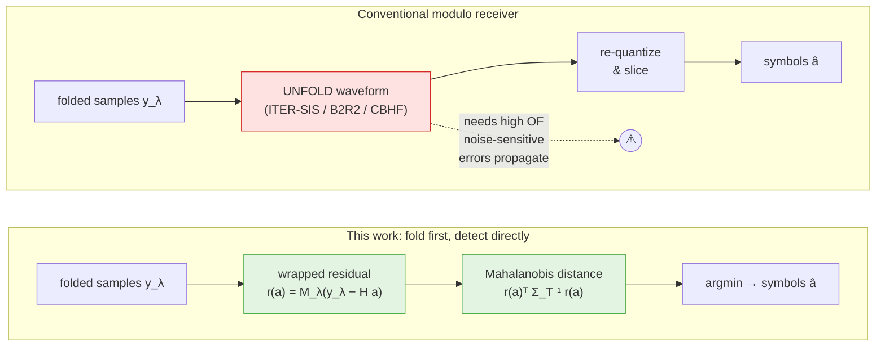
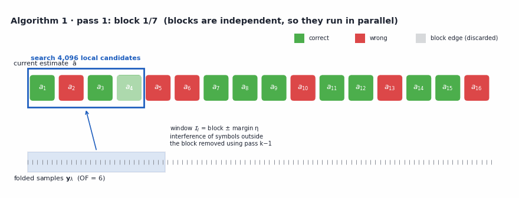
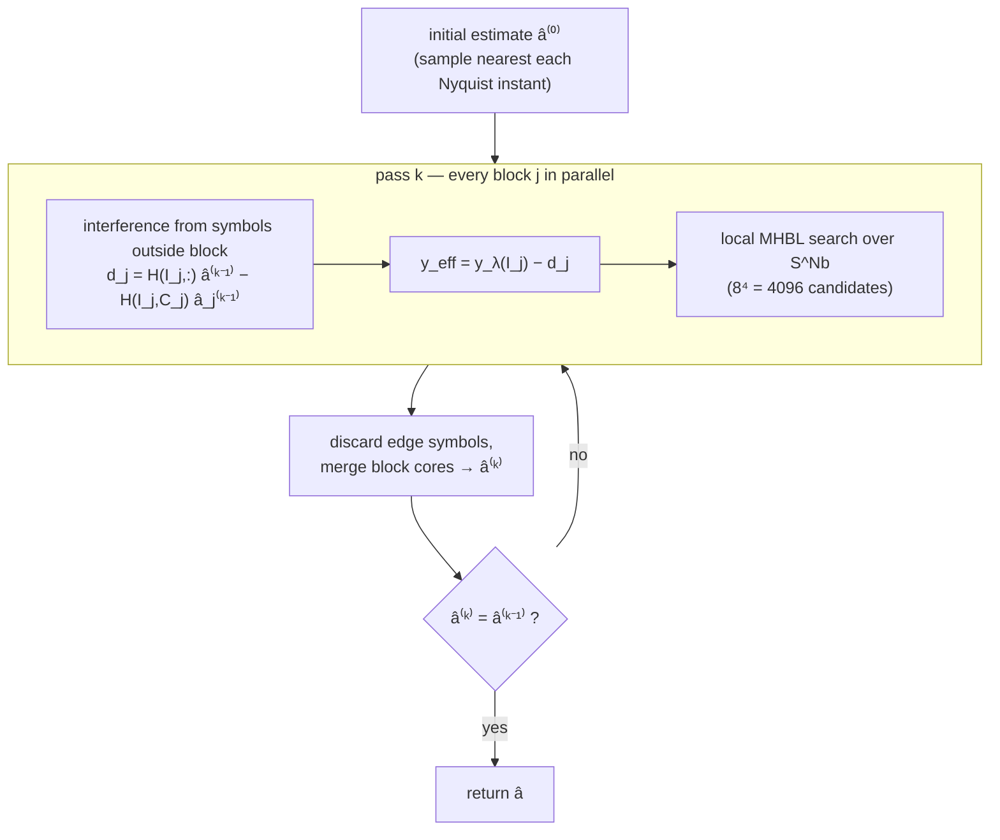
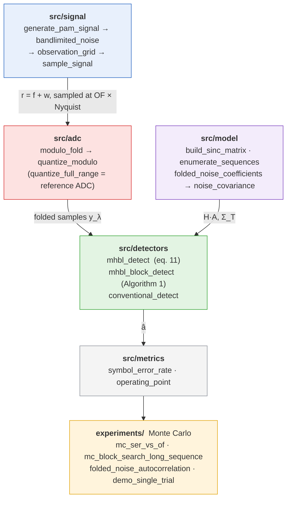
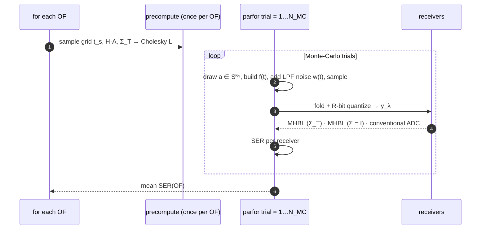

<p align="center">
  
</p>

<p align="center">
  <a href="https://arxiv.org/abs/2609.11298"></a>
  
  
  
  <a href="LICENSE"></a>
</p>

<p align="center">
  <b>Krunal Vaghela</b>, Kumar Appaiah, Satish Mulleti<br>
  Department of Electrical Engineering, IIT Bombay &nbsp;·&nbsp; Bachelor's thesis project
</p>

---

> **TL;DR.** A *modulo-ADC* folds a large signal into a small range $[-\lambda,\lambda)$ so that a cheap, few-bit ADC can sample it without clipping. Usually the folds must be undone ("unfolding") before anything else can happen, which is fragile and needs heavy oversampling. For a communication receiver the goal is the **symbols**, not the waveform. This work detects the symbols **directly from the folded samples**: an exact maximum-likelihood rule that never unfolds, plus a block search whose cost grows **linearly** with sequence length.

| | |
|---|---|
| **Problem** | Detect PAM symbols from oversampled, folded and coarsely quantized samples $\mathbf{y}_\lambda = \mathcal{M}_\lambda(\mathbf{H}\mathbf{a}+\mathbf{w})+\mathbf{q}$ |
| **Key idea** | *Wrap cancellation*: for the correct hypothesis the unknown fold integers drop out, which leaves a single Mahalanobis distance on the wrapped residual |
| **Scaling** | Block-decomposed search (Algorithm 1): $\mathcal{O}(N_s)$ instead of $\mathcal{O}(\lvert\mathcal{S}\rvert^{N_s})$ |
| **Outcome** | Outperforms the ITER-SIS, B2R2 and CBHF unfolding baselines and approaches an unclipped high-resolution ADC. Details are in the [paper](https://arxiv.org/abs/2609.11298) |

---

## 1 · What does a modulo-ADC do?

<p align="center">
  
</p>

The centred modulo operator

```math
\mathcal{M}_\lambda(x) \;=\; \mathrm{mod}(x+\lambda,\;2\lambda)-\lambda \;\in\; [-\lambda,\lambda)
```

wraps the signal every time it crosses $\pm\lambda$. A signal with peak amplitude $c \gg \lambda$ (here $c/\lambda \approx 5$) is mapped into a narrow band, so a few-bit quantizer is enough. Equivalently $x = \mathcal{M}_\lambda(x) + 2\lambda z$ for an integer $z$. That integer is the information the folding "hides".

## 2 · Receiver pipeline

<p align="center">
  
  <br><sub><i>Fig. 1 of the paper: the low-pass filter output is folded, sampled at OF × Nyquist and quantized to 2<sup>R</sup> levels. The samples go <b>straight</b> to the detector.</i></sub>
</p>

## 3 · The idea: skip the unfolding step



**Why it works: wrap cancellation.** Write $\mathbf{y}_\lambda = \mathbf{H}\mathbf{a} + \mathbf{w} + 2\lambda\mathbf{z} + \mathbf{q}$. For the *true* symbols,

```math
\mathbf{r}(\mathbf{a}) \;=\; \mathcal{M}_\lambda(\mathbf{y}_\lambda-\mathbf{H}\mathbf{a})
\;=\; \mathcal{M}_\lambda(\mathbf{w}+\mathbf{q}+2\lambda\mathbf{z})
\;=\; \mathcal{M}_\lambda(\mathbf{w}+\mathbf{q})
\;\approx\; \mathbf{w}+\mathbf{q},
```

because $2\lambda\mathbb{Z}^N$ is the kernel of $\mathcal{M}_\lambda$ and the noise rarely exceeds $\lambda$. The unknown folds $\mathbf{z}$ vanish exactly, so the likelihood collapses to a single Gaussian term and the ML detector becomes

```math
\hat{\mathbf{a}} \;=\; \arg\min_{\mathbf{a}\in\mathcal{S}^{N_s}}\; \mathbf{r}(\mathbf{a})^{\top}\,\boldsymbol{\Sigma}_T^{-1}\,\mathbf{r}(\mathbf{a}),
\qquad \boldsymbol{\Sigma}_T = \boldsymbol{\Sigma}_w + \sigma_q^2\mathbf{I}.
```

<p align="center">
  
</p>

The covariance $\boldsymbol{\Sigma}_T$ is not a guess. The paper derives the exact autocorrelation of *folded* Gaussian noise from a Fourier series of the sawtooth and the bivariate characteristic function,

```math
R_Y(\tau)=\sum_{m\ge 0}A_{2m+1}\,\rho(\tau)^{2m+1},\qquad \rho(\tau)=\mathrm{sinc}(2W\tau),
```

and shows that the uniform quantization noise only inflates the diagonal, to second order (Appendices A and B).

## 4 · Scaling to long sequences: block search (Algorithm 1)

Exhaustive search over $N_s = 64$ symbols from an 8-ary alphabet means $8^{64}\approx 6\times10^{57}$ hypotheses. Sinc pulses decay as $1/|t|$ and the noise correlation dies out, so the sequence can be split into overlapping blocks:

<p align="center">
  
</p>



| | Exhaustive ML | Block search (Algorithm 1) |
|---|---|---|
| Cost | $\mathcal{O}(\mathrm{OF}^2 N_s^2\,\lvert\mathcal{S}\rvert^{N_s})$ | $\mathcal{O}(K\,P\,\mathrm{OF}^2(N_b+2\eta)^2\,\lvert\mathcal{S}\rvert^{N_b})$ |
| Growth in $N_s$ | exponential | **linear** |
| Parallel | no | yes, blocks are independent within a pass |

---

## 5 · Code

All simulations are in MATLAB. The code is organised so that **each step of the receiver is one function** with a descriptive name and a header that points to the matching equation in the paper.



<details open>
<summary><b>What every file does</b></summary>

| File | Role | Paper |
|---|---|---|
| **`src/signal/`** | | |
| `generate_pam_signal.m` | Sinc-pulse PAM signal $f(t)=\sum_m a_m\,\mathrm{sinc}(2W(t-t_m))$ on a dense time grid | §2 |
| `symbol_times.m` | Pulse centres $t_m$, one Nyquist period apart | §2 |
| `bandlimited_noise.m` | White noise → brick-wall LPF, giving correlated noise with $R_w(\tau)=\sigma_{\rm lpf}^2\,\mathrm{sinc}(2W\tau)$ | §2 |
| `observation_grid.m` | ADC sampling instants at $F_s=\mathrm{OF}\cdot 2W$ inside the observation window | §2, Fig. 2 |
| `sample_signal.m` | Uniform sampling of the dense-grid signal | §2 |
| **`src/adc/`** | | |
| `modulo_fold.m` | Centred modulo $\mathcal{M}_\lambda(\cdot)$ | eq. 1–2 |
| `quantize_modulo.m` | $R$-bit quantizer on $[-\lambda,\lambda)$, $\Delta = 2\lambda/2^R$ | §2 |
| `quantize_full_range.m` | Conventional (unfolded) ADC used as the reference | §4 |
| **`src/model/`** | | |
| `build_sinc_matrix.m` | Interpolation matrix $[\mathbf{H}]_{n,m}=\mathrm{sinc}(2W(t_n-t_m))$ | §2 |
| `enumerate_sequences.m` | All $\lvert\mathcal{S}\rvert^{N}$ candidate symbol vectors | §3 |
| `folded_noise_coefficients.m` | Series coefficients $A_{2m+1}$ of the folded-noise autocorrelation (50-digit `vpa`) | App. A |
| `noise_covariance.m` | $\boldsymbol{\Sigma}_T = \boldsymbol{\Sigma}_Y + \sigma_q^2\mathbf{I}$ | eq. 10, App. B |
| `safe_cholesky.m` | Cholesky factor, so $\mathbf{r}^\top\boldsymbol{\Sigma}^{-1}\mathbf{r}=\lVert\mathbf{L}^{-1}\mathbf{r}\rVert^2$ is computed without an explicit inverse | – |
| `injective_pam_alphabet.m` | 8-PAM alphabets that stay distinguishable after folding ($\lambda=1,2,3$) | §4 |
| **`src/detectors/`** | | |
| `mhbl_detect.m` | **Exhaustive Mahalanobis (MHBL) ML detector**, the core contribution | eq. 11 |
| `build_block_info.m` | Precomputes blocks: index sets $\mathcal{I}_j,\mathcal{C}_j$, sub-matrices of $\mathbf{H}$, local Cholesky factors | §3.2 |
| `mhbl_block_detect.m` | **Algorithm 1**: Jacobi (parallel) or Gauss–Seidel block search with cycle detection | §3.2, Alg. 1 |
| `peak_init.m` | Initial estimate from the samples nearest each Nyquist instant | §3.2 |
| `conventional_detect.m`, `conventional_block_detect.m` | Minimum-Euclidean receivers for the unclipped ADC reference | §4 |
| **`src/metrics/`** | | |
| `symbol_error_rate.m` | SER in % | §4 |
| `operating_point.m` | Compression ratio $c/\lambda$ and pre-folding in-band SNR | §4 |
| **`experiments/`** | | |
| `demo_single_trial.m` | One transmission end to end, with plots of every stage | – |
| `mc_ser_vs_of.m` | Monte-Carlo SER vs oversampling factor: MHBL vs ablation ($\boldsymbol{\Sigma}=\mathbf{I}$) vs conventional ADC | §4 |
| `mc_block_search_long_sequence.m` | Monte-Carlo SER and decode time for $N_s = 64$ with Algorithm 1 | §4 |
| `folded_noise_autocorrelation.m` | Checks the Appendix-A series against simulated folded noise | App. A |
| `tests/run_smoke_tests.m` | Fast end-to-end checks (modulo kernel, wrap cancellation, noiseless SER = 0, …) | – |
| `docs/make_figures.py` | Regenerates every figure and animation in this README | – |

</details>

### Monte-Carlo loop (`mc_ser_vs_of.m`)



---

## 6 · Quick start

Requires **MATLAB R2022b or newer** with the **Signal Processing Toolbox** (`lowpass`, `xcorr`). The **Symbolic Math Toolbox** is optional (high-precision series coefficients) and so is the **Parallel Computing Toolbox** (`parfor`).

```matlab
>> setup_paths                     % add src/ and experiments/ to the path
>> run_smoke_tests                 % ~1 min sanity check of the whole pipeline
>> demo_single_trial               % one transmission, step-by-step plots
```

Every experiment is a function that takes an optional `cfg` struct, so any parameter can be changed without editing the file:

```matlab
>> res = mc_ser_vs_of(struct('lambda', 2, 'OF_vec', [2 5 10], 'num_mc', 500));
>> res = mc_block_search_long_sequence(struct('NoS', 64, 'R_mhbl', 5, 'R_conv', 8));
>> res = folded_noise_autocorrelation(struct('ratios', [4 3 2]));
```

| Key parameter | Meaning | Default |
|---|---|---|
| `lambda` | modulo threshold $\lambda$ | 1 |
| `sigma_lpf` | in-band channel-noise std $\sigma_{\rm lpf}$ | $\lambda/3$ |
| `OF_vec` | oversampling factors to sweep | 2 … 30 |
| `R_mhbl` / `R_conv` | bits of the modulo-ADC / conventional ADC | 3 / 6 |
| `NoS` | symbols per sequence $N_s$ | 4 (exhaustive), 64 (block) |
| `num_mc` | Monte-Carlo trials per point (500 in the paper) | 100 |

To regenerate the README figures: `python docs/make_figures.py` (numpy, matplotlib, pillow).

> **Baselines.** The comparison algorithms (ITER-SIS, B2R2, CBHF) are other authors' methods and are not redistributed here. See their papers, [21]–[22] and [19] in the reference list.

---

## 7 · Citation

```bibtex
@misc{vaghela2026foldfirst,
  title         = {Fold First, Detect Directly: Communication Symbol Detection Without
                   Unfolding for Low-Bitrate Modulo-ADCs},
  author        = {Vaghela, Krunal and Appaiah, Kumar and Mulleti, Satish},
  year          = {2026},
  eprint        = {2609.11298},
  archivePrefix = {arXiv},
  primaryClass  = {eess.SP},
  note          = {Under review at IEEE ICASSP 2027}
}
```

## Acknowledgements

Bachelor's thesis work in the Department of Electrical Engineering, IIT Bombay, under the guidance of **Prof. Satish Mulleti** and **Prof. Kumar Appaiah**.
