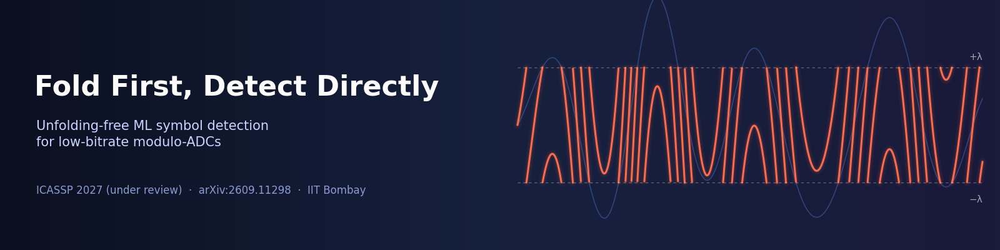
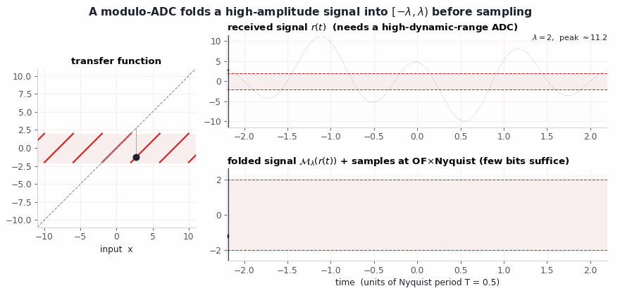
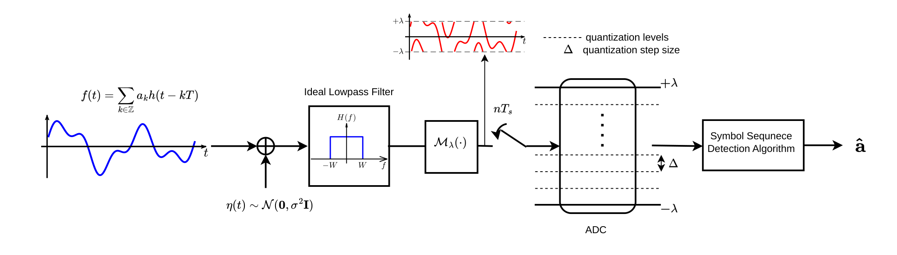
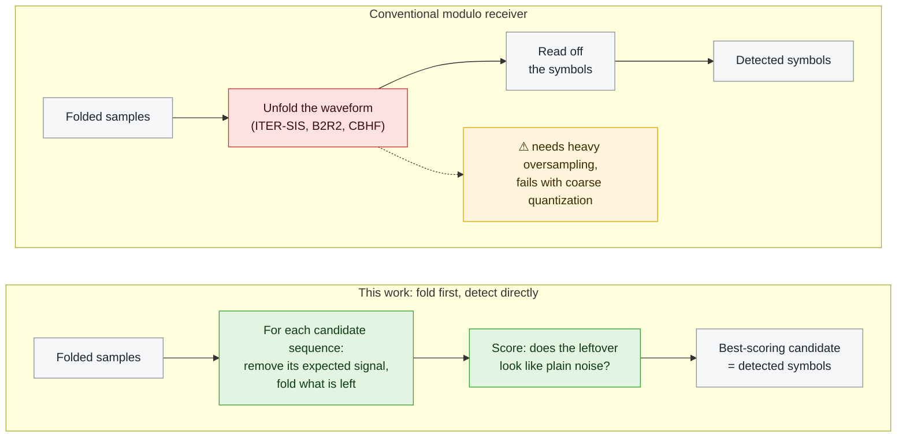
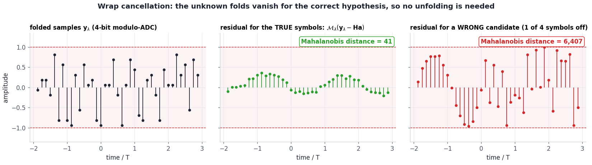
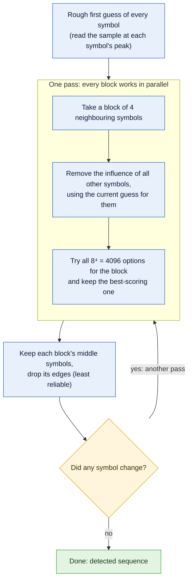
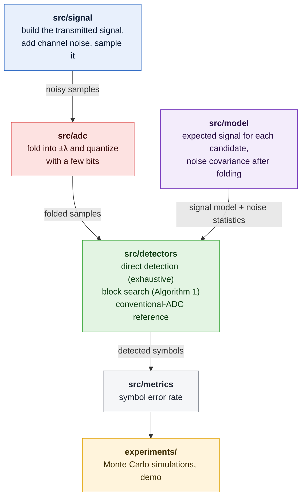
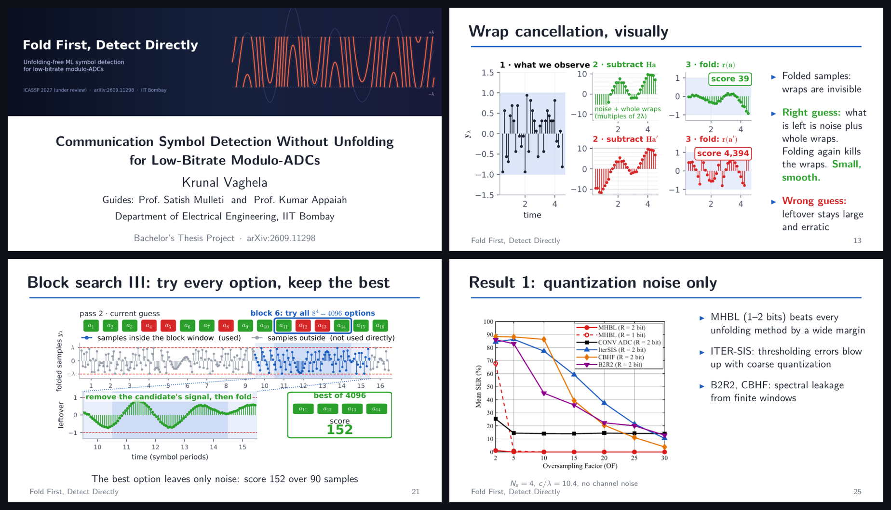

<p align="center">
  
</p>

<p align="center">
  <a href="https://arxiv.org/abs/2609.11298"></a>
  
  <a href="docs/BTP_presentation.pdf"></a>
  
  
  <a href="LICENSE"></a>
</p>

<p align="center">
  <b>Krunal Vaghela</b>, Kumar Appaiah, Satish Mulleti<br>
  Department of Electrical Engineering, IIT Bombay &nbsp;·&nbsp; Bachelor's thesis project
</p>

---

> **TL;DR.** A *modulo-ADC* folds a large signal back into a small range, ±λ, so that a cheap ADC with only a few bits can sample it without clipping. Normally the folds must be undone first ("unfolding"), which is fragile and needs heavy oversampling. A communication receiver only needs the **symbols**, not the waveform. This work detects the symbols **directly from the folded samples**, with an exact maximum-likelihood rule that never unfolds, plus a block search whose cost grows only **linearly** with the number of symbols.

| | |
|---|---|
| **Problem** | Recover the transmitted symbols when the receiver only sees *folded*, oversampled samples quantized with just 1–5 bits |
| **Key idea** | *Wrap cancellation*: when you test the correct symbols, the unknown folds cancel out, leaving pure noise. So each candidate can be scored with a single noise-likelihood test, and nothing ever has to be unfolded |
| **Scaling** | A block search (Algorithm 1) checks a few symbols at a time, so the cost grows linearly with sequence length instead of exponentially |
| **Outcome** | Outperforms the ITER-SIS, B2R2 and CBHF unfolding methods and comes close to an ideal high-resolution ADC. Details are in the [paper](https://arxiv.org/abs/2609.11298) |

---

## 1 · What does a modulo-ADC do?

<p align="center">
  
</p>

Whenever the signal crosses +λ or −λ, the modulo-ADC wraps it around to the other side, like an odometer rolling over:

```math
\mathcal{M}_\lambda(x) \;=\; \mathrm{mod}(x+\lambda,\;2\lambda)-\lambda
```

A signal that swings up to ±11 (here λ = 2) ends up inside a narrow band, so a few-bit quantizer is enough. What gets lost is *how many times* each sample was wrapped. Classical receivers spend a lot of effort recovering that count. This work doesn't need it.

## 2 · Receiver pipeline

<p align="center">
  
  <br><sub><i>Fig. 1 of the paper: the low-pass filtered signal is folded, sampled faster than Nyquist and quantized with a few bits. The samples go <b>straight</b> to the symbol detector.</i></sub>
</p>

## 3 · The idea: skip the unfolding step



**Why it works: wrap cancellation.** Suppose you guess the symbols correctly and subtract the signal they would produce. What remains is the noise *plus some unknown number of full wraps*. Folding that leftover once more removes every full wrap, because adding exactly one wrap (2λ) changes nothing after folding:

```math
\text{fold}\big(\,\text{samples} - \text{signal of the correct symbols}\,\big) \;=\; \text{fold}\big(\,\text{noise} + \text{whole wraps}\,\big) \;=\; \text{noise}
```

So for the right guess the leftover is just small, smooth noise. For a wrong guess it is large and erratic. The detector picks the candidate whose leftover looks most like the receiver noise, using a Mahalanobis distance, which accounts for the noise being correlated between neighbouring samples:

```math
\hat{\mathbf{a}} \;=\; \arg\min_{\mathbf{a}} \; \mathbf{r}(\mathbf{a})^{\top}\,\boldsymbol{\Sigma}^{-1}\,\mathbf{r}(\mathbf{a}),
\qquad \mathbf{r}(\mathbf{a}) = \text{folded leftover for candidate } \mathbf{a}
```

<p align="center">
  
</p>

The noise covariance Σ isn't a guess. The paper derives exactly how folding changes the noise statistics, using a Fourier series of the folding function, and shows that the quantization error simply adds a small constant to the diagonal (Appendices A and B).

## 4 · Scaling to long sequences: block search (Algorithm 1)

Checking every possible sequence of 64 symbols from an 8-level alphabet means 8⁶⁴ ≈ 6 × 10⁵⁷ candidates, which is impossible. Two facts help. Each symbol's pulse fades quickly in time, and the noise correlation dies out too. So the sequence can be solved a few symbols at a time:

<p align="center">
  
</p>



| | Check every sequence | Block search (Algorithm 1) |
|---|---|---|
| Candidates for 64 symbols | 8⁶⁴ ≈ 6 × 10⁵⁷ | a few thousand per block, a few dozen blocks |
| Cost as the sequence gets longer | grows exponentially | grows **linearly** |
| Can run in parallel? | no | yes, all blocks in a pass are independent |

---

## 5 · Code

All simulations are in MATLAB. Each step of the receiver is **one function with a descriptive name**, and its header points to the matching equation in the paper.



<details open>
<summary><b>What every file does</b></summary>

| File | What it does | Paper |
|---|---|---|
| **`src/signal/`** | | |
| `generate_pam_signal.m` | Builds the transmitted signal: one sinc pulse per symbol, scaled by the symbol value | §2 |
| `symbol_times.m` | Time at which each symbol's pulse peaks (one Nyquist period apart) | §2 |
| `bandlimited_noise.m` | Channel noise after the receiver's low-pass filter (correlated between nearby samples) | §2 |
| `observation_grid.m` | Times at which the ADC samples, at OF × the Nyquist rate | §2, Fig. 2 |
| `sample_signal.m` | Takes the samples at those times | §2 |
| **`src/adc/`** | | |
| `modulo_fold.m` | The folding operation: wraps any value into ±λ | eq. 1–2 |
| `quantize_modulo.m` | Few-bit quantizer for the folded range ±λ | §2 |
| `quantize_full_range.m` | Ordinary ADC (no folding) covering the full signal range, used as the reference | §4 |
| **`src/model/`** | | |
| `build_sinc_matrix.m` | Maps symbols to noiseless samples: the expected signal for any candidate | §2 |
| `enumerate_sequences.m` | Lists every possible candidate symbol sequence | §3 |
| `folded_noise_coefficients.m` | Series coefficients describing how folding reshapes the noise correlation | App. A |
| `noise_covariance.m` | Full noise covariance used for scoring: folded channel noise + quantization noise | eq. 10, App. B |
| `safe_cholesky.m` | Numerically stable factorization, so the score never needs an explicit matrix inverse | – |
| `injective_pam_alphabet.m` | 8-level symbol alphabets chosen so that no two symbols look the same after folding | §4 |
| **`src/detectors/`** | | |
| `mhbl_detect.m` | **The proposed detector**: scores every candidate on its folded leftover and picks the best | eq. 11 |
| `build_block_info.m` | Precomputes everything each block needs for the block search | §3.2 |
| `mhbl_block_detect.m` | **Algorithm 1**: block search for long sequences (parallel or sequential updates) | §3.2 |
| `peak_init.m` | Rough first guess from the sample at each symbol's peak | §3.2 |
| `conventional_detect.m`, `conventional_block_detect.m` | Reference receiver using an ordinary high-resolution ADC | §4 |
| **`src/metrics/`** | | |
| `symbol_error_rate.m` | Percentage of symbols detected wrongly | §4 |
| `operating_point.m` | How strongly the signal is folded, and the signal-to-noise ratio | §4 |
| **`experiments/`** | | |
| `demo_single_trial.m` | One transmission end to end, with plots of every stage | – |
| `mc_ser_vs_of.m` | Monte Carlo: error rate vs oversampling factor for the proposed detector and the reference ADC | §4 |
| `mc_block_search_long_sequence.m` | Monte Carlo: 64-symbol sequences with the block search, error rate and decoding time | §4 |
| `folded_noise_autocorrelation.m` | Checks the derived noise statistics against simulation | App. A |
| `tests/run_smoke_tests.m` | Quick end-to-end checks of the whole pipeline (~1 minute) | – |
| `docs/make_figures.py` | Regenerates every figure and animation in this README | – |
| `docs/BTP_presentation.pdf` | Bachelor's Thesis Project presentation (33 slides) | – |

</details>

---

## 6 · Quick start

Requires **MATLAB R2022b or newer** with the **Signal Processing Toolbox**. The **Symbolic Math Toolbox** (higher-precision noise coefficients) and the **Parallel Computing Toolbox** (faster Monte Carlo) are optional.

```matlab
>> setup_paths                     % add src/ and experiments/ to the path
>> run_smoke_tests                 % ~1 min sanity check of the whole pipeline
>> demo_single_trial               % one transmission, step-by-step plots
```

Every experiment takes an optional settings struct, so any parameter can be changed without editing the file:

```matlab
>> res = mc_ser_vs_of(struct('lambda', 2, 'OF_vec', [2 5 10], 'num_mc', 500));
>> res = mc_block_search_long_sequence(struct('NoS', 64, 'R_mhbl', 5, 'R_conv', 8));
>> res = folded_noise_autocorrelation(struct('ratios', [4 3 2]));
```

| Setting | Meaning | Default |
|---|---|---|
| `lambda` | folding threshold λ | 1 |
| `sigma_lpf` | channel-noise level | λ / 3 |
| `OF_vec` | oversampling factors to test | 2 … 30 |
| `R_mhbl` / `R_conv` | bits of the modulo-ADC / of the ordinary ADC | 3 / 6 |
| `NoS` | number of symbols per sequence | 4 (exhaustive), 64 (block search) |
| `num_mc` | Monte Carlo trials per point (500 in the paper) | 100 |

To regenerate the README figures: `python docs/make_figures.py` (numpy, matplotlib, pillow).

> **Baselines.** The comparison methods (ITER-SIS, B2R2, CBHF) were developed by other authors and are not redistributed here. See the reference list of the paper.

---

## 7 · Slides

The 33-slide presentation of this work as my **Bachelor's Thesis Project** at IIT Bombay (guides: Prof. Satish Mulleti and Prof. Kumar Appaiah). It tells the story in six questions: why a modulo-ADC, why not unfold, how to detect directly, how to scale to long sequences, how well it works, and what comes next (towards OFDM).

<p align="center">
  <a href="docs/BTP_presentation.pdf"></a>
  <br><sub>Click for the full deck (PDF).</sub>
</p>

## 8 · Citation

```bibtex
@misc{vaghela2026foldfirst,
  title         = {Fold First, Detect Directly: Communication Symbol Detection Without
                   Unfolding for Low-Bitrate Modulo-ADCs},
  author        = {Vaghela, Krunal and Appaiah, Kumar and Mulleti, Satish},
  year          = {2026},
  eprint        = {2609.11298},
  archivePrefix = {arXiv},
  primaryClass  = {eess.SP},
  note          = {Under review at IEEE ICASSP 2027}
}
```

## Acknowledgements

Bachelor's thesis work in the Department of Electrical Engineering, IIT Bombay, under the guidance of **Prof. Satish Mulleti** and **Prof. Kumar Appaiah**.
